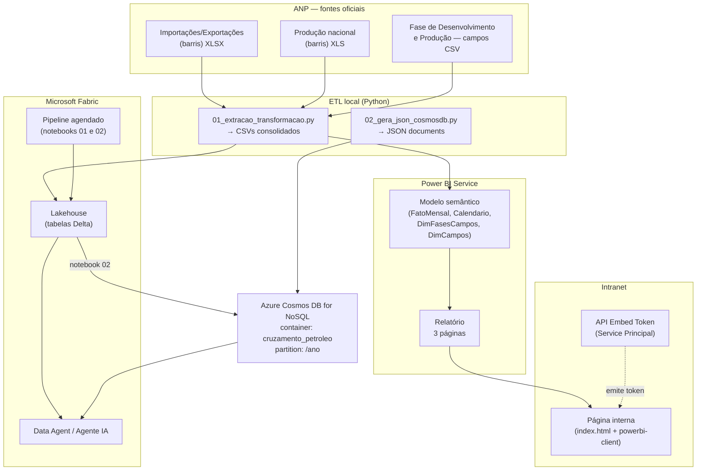
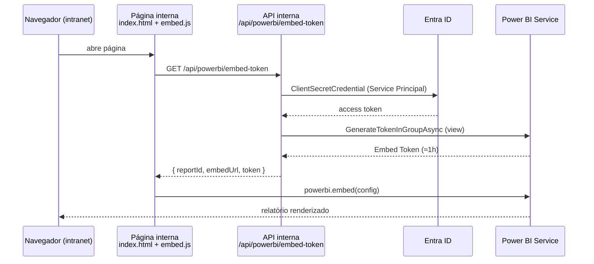

# PROJETO_ENGENHARIA_DE_DADOS_ETL_AO_FABRIC
ETL realtivo a Extração, Tratamento e Carga de dados publicos, geração de POWER BI e posterior codigo ao Fabric

01.Arquitetura.md
# 01 — Arquitetura da solução

## Visão geral

A solução conecta três mundos em um fluxo único de dados públicos:

1. **Extração** dos dados oficiais da ANP (planilhas estatísticas + dados abertos
   da Fase de Desenvolvimento e Produção);
2. **Curadoria** local em CSVs/JSON padronizados (ETL Python reprodutível);
3. **Consumo analítico** via Power BI publicado na intranet corporativa;
4. **Materialização** do resultado no **Azure Cosmos DB for NoSQL** através do
   **Microsoft Fabric**, servindo como fonte para o **Agente de Análise** (IA).

## Fluxo end-to-end



## Camadas e responsabilidades

| Camada | Componente | Responsabilidade |
|---|---|---|
| Fonte | Planilhas ANP | Dados brutos oficiais, atualização mensal |
| Ingestão | `scripts/*.py` | Parsing do layout “relatório”, tipagem, validações |
| Armazenamento curado | `data/processed/` | Fato mensal/anual + dimensões + JSON Cosmos |
| Analítico | Modelo semântico Power BI | Medidas DAX do cruzamento; governança via workspace |
| Apresentação | Página intranet | Embed seguro do relatório (`app owns data`) |
| Nuvem | Fabric Lakehouse + Pipeline | Reprocessamento agendado na nuvem |
| NoSQL | Cosmos DB container | Documentos por ano; baixa latência p/ agentes |
| IA | Fabric Data Agent / AI Foundry | Perguntas em linguagem natural sobre o cruzamento |

## Princípios adotados

- **Reprodutibilidade**: todo dado derivado nasce de script versionado — nenhum
  valor foi digitado manualmente.
- **Validação dupla**: os totais anuais são confrontados com números publicados
  pela própria ANP (Boletim Mensal, Anuário Estatístico).
- **Segurança**: embed interno com Service Principal + capacity; acesso ao
  Cosmos DB somente via Entra ID (RBAC), sem chaves primárias em código.
- **Baixo acoplamento**: a página web só depende do endpoint interno de token;
  o Cosmos DB é alimentado pelo pipeline da Fabric, não pela página.

## Frequência de atualização

| Processo | Frequência | Gatilho |
|---|---|---|
| Publicação ANP | Mensal (dia subsequente ao mês de referência) | — |
| ETL local → CSVs | Sob demanda / CI | Execução manual ou pipeline GitHub Actions |
| Refresh Power BI | Diário (após carga) | Gateway/agendamento do dataset |
| Pipeline Fabric → Cosmos DB | Mensal (dia 5, 04h UTC) | ScheduleTrigger do pipeline |

02-fonte de dados.md
# 02 — Fontes de dados, metodologia e validação

## Fontes oficiais utilizadas

Os três arquivos de referência do trabalho correspondem a publicações oficiais
da ANP, baixados em 25/08/2026 (dados “atualizados em 31/7/2026”):

### 1. Dados Estatísticos — Importações & Exportações (barris)
- **Arquivo**: `data/raw/importacoes-exportacoes-b.xlsx` (XLSX, 1 aba, ~1.200 linhas, 19 tabelas empilhadas)
- **URL**: https://www.gov.br/anp/pt-br/centrais-de-conteudo/dados-estatisticos/de/ie/importacoes-exportacoes-b.xlsx
- **Conteúdo relevante ao projeto**:
  - `Importação de petróleo - 2000-2026 (b)` — tabela mensal
  - `Exportação de petróleo - 2000-2026 (b)` — tabela mensal
- **Notas da própria fonte**: petróleo inclui óleo e condensado; não inclui LGN;
  dados de comércio exterior: Secretaria de Comércio Exterior (Secex).

### 2. Dados Estatísticos — Produção Nacional de Petróleo e LGN (barris)
- **Arquivo**: `data/raw/producao-petroleo-b.xls` (XLS legado)
- **URL**: https://www.gov.br/anp/pt-br/centrais-de-conteudo/dados-estatisticos/de/ppg/producao-petroleo-b.xls
- **Tabela usada**: primeira do arquivo — filtros `BRASIL` / `PETRÓLEO TOTAL (b)`,
  série mensal 2000–2026. A segunda tabela (LGN) não entra no cruzamento.

### 3. Dados Abertos — Fase de Desenvolvimento e Produção (campos)
- **Arquivo**: `data/raw/extracao-campo.csv` (442 campos × 15 colunas)
- **URL**: https://www.gov.br/anp/pt-br/centrais-de-conteudo/dados-abertos/arquivos/arquivos-fase-de-desenvolvimento-e-producao/informacoes-sobre-campos/extracao-campo.csv
- **Colunas**: código/nome do campo, bacia, estado, operador, ambiente (mar/terra),
  rodada, contrato, situação (`Produção`, `Desenvolvimento`, `Em Devolução`,
  `Em devolução, licitado`), datas de assinatura, término de fase, início e
  término de produção.

## Metodologia de extração

As planilhas da ANP são relatórios formatados para leitura humana: várias
tabelas empilhadas na mesma aba, títulos fora da grade, separadores visuais
(`xxxx...`) e notas de rodapé. O ETL (`scripts/01_extracao_transformacao.py`)
implementa um parser genérico:

1. Localiza toda linha cuja célula contém exatamente `ANO` → cabeçalho de tabela;
2. Na linha seguinte identifica a coluna `Mês/MÊS/Meses` e as colunas-anos numéricas;
3. Consome as linhas seguintes enquanto o rótulo for um mês válido
   (`janeiro…dezembro`, acento-insensível), parando em `Total do Ano` /
   `Média do Ano`;
4. Reconstrói o título de cada tabela pelas linhas de texto acima do cabeçalho
   (atravessando no máximo um separador visual);
5. Seleciona a tabela correta por prefixo do título
   (`Importação de petróleo`, `Exportação de petróleo`, `PETRÓLEO TOTAL`);
6. Filtra os anos-alvo (2020–2025), valida completude (72 meses, zero nulos) e
   grava CSVs UTF-8 com ponto decimal.

### Derivação das fases contratuais por ano

Para cada ano Y:
- **Campos em Produção** = campos com `SITUACAO_CAMPO = 'Produção'`,
  `DATA_INICIO_PRODUCAO ≤ 31/12/Y` e `TERMINO_FASE > 31/12/Y`;
- **Campos em Desenvolvimento** = campos com `SITUACAO_CAMPO = 'Desenvolvimento'`
  e produção já iniciada até Y;
- Campos `Em Devolução` / `Em devolução, licitado` ficam fora dos dois
  quantitativos (regra documentada e facilmente ajustável no script).

## Validação contra publicações oficiais

| Métrica | Valor calculado | Valor oficial ANP | Referência |
|---|---|---|---|
| Produção 2025 | 3,77 mi bbl/d | **3,770 mi bbl/d** | Boletim Mensal dez/2025 (recorde histórico) |
| Produção 2024 | 3,36 mi bbl/d | 3,4 mi bbl/d | Anuário Estatístico 2025 |
| Exportação 2024 | 1,74 mi bbl/d | 1,7 mi bbl/d | Anuário Estatístico 2025 |
| Importação 2024 | 282 mil bbl/d | **282 mil bbl/d** | Anuário Estatístico 2025 |
| Produção 2023 | 1,242 bi bbl | ≈197,4 mi m³ (=1,242 bi bbl) | Conversão 1 m³ = 6,2898 bbl |

Divergências menores (<1%) decorrem de arredondamento nas publicações.

## Dicionário de dados (saídas)

### `fato_mensal_2020_2025.csv`
| Coluna | Tipo | Descrição |
|---|---|---|
| DATA | date (ISO) | Primeiro dia do mês |
| ANO / TRIMESTRE / MES_NUM / MES_NOME | int/text | Atributos de tempo |
| PRODUCAO_BARRIS | double | Produção nacional de petróleo no mês (barris) |
| IMPORTACAO_BARRIS | double | Importação de petróleo no mês (barris) |
| EXPORTACAO_BARRIS | double | Exportação de petróleo no mês (barris) |
| BALANCA_COMERCIAL_BARRIS | double | Exportação − Importação (barris) |

### `fato_anual_2020_2025.csv`
Acumula o fato mensal por ano e acrescenta `*_YOY_PCT` (variação % ano contra
ano), `COBERTURA_EXPORT_PCT` (exportação ÷ produção) e
`DEPENDENCIA_IMPORT_PCT` (importação ÷ produção), além das colunas de fases
contratuais.

### `cosmosdb/cruzamento_anp_2020_2025.json`
Um documento por ano (`id = anp-petroleo-YYYY`, partition `/ano`) com blocos
`producao`, `comercio_exterior`, `fases_contratuais`, `indicadores` e série
`mensal`.

## Limitações conhecidas

- O CSV oficial de campos não traz volumes produzidos por campo — por isso o
  volume vem da planilha de produção nacional e a dimensão de fases contribui
  com quantitativos e contexto contratual.
- Séries 2026 existem parcialmente nas fontes; o escopo do projeto é 2020–2025.

03.modelo-power.bi.md
# 03 — Modelo Power BI (modelagem, DAX e relatório)

## 1. Criar o projeto no Power BI Desktop

1. Abra o **Power BI Desktop** → `Transformar dados` → `Editor do Power Query`.
2. Crie uma **Consulta Nula**, renomeie para `Parametros`, abra o
   **Editor Avançado** e cole o primeiro bloco de
   [`powerbi/consultas-m/consultas_powerbi.m`](../powerbi/consultas-m/consultas_powerbi.m),
   ajustando `CAMINHO_DADOS` para a pasta `data/processed/` local
   (ou caminho OneLake — ver §5).
3. Repita para cada bloco: `FatoMensal`, `FatoAnual`, `DimFasesCampos`,
   `DimCampos`, `DimCalendario`.
4. `Página Inicial` → `Fechar e Aplicar`.

> Em ambiente corporativo com Fabric, substitua `File.Contents` por
> `Csv.Document(Web.Contents("https://onelake..."))` apontando para o Lakehouse
> (mesmos arquivos publicados pelo pipeline) — mantém um único ponto de verdade.

## 2. Relacionamentos (Exibição de Modelo)

| De (tabela*coluna) | Para | Cardinalidade | Direção |
|---|---|---|---|
| Calendario[Data] | FatoMensal[DATA] | 1:* | Única |
| DimCampos[SITUACAO_CAMPO] | — | sem relação física (dimensão de apoio) | — |
| DimFasesCampos[ANO] | FatoMensal[ANO] | **sem relação física** — contexto via `TREATAS` | — |

`DimFasesCampos` é anual enquanto o fato é mensal; usar `TREATAS` nas medidas
evita ambiguidade many-to-many e mantém filtros corretos em visuais mistos.

## 3. Medidas DAX

Cole as medidas de [`powerbi/dax/medidas.dax`](../powerbi/dax/medidas.dax)
na tabela `FatoMensal`. Principais:

| Medida | Fórmula-resumo | Uso no relatório |
|---|---|---|
| Produção (bi bbl) | Σ produção ÷ 10⁹ | Cards e linhas |
| Exportação / Importação (bi bbl) | Σ ÷ 10⁹ | Cards e colunas empilhadas |
| Balança Comercial (bi bbl) | Σ(export−import) ÷ 10⁹ | Coluna/linha combinada |
| Cobertura Exportação % | export ÷ produção | Indicador-chave do cruzamento |
| Dependência Importação % | import ÷ produção | Indicador-chave |
| Produção Média (bbl/dia) | média ponderada dias/mês | Comparação com boletins ANP |
| Variação YoY Produção/Export/Import % | vs. `SAMEPERIODLASTYEAR` | Títulos de cartões, tooltips |
| Campos em Produção / Desenvolvimento | `MAX` + `TREATAS(VALUES(FatoMensal[ANO]), DimFasesCampos[ANO])` | Linha secundária nos gráficos |
| Produção Média por Campo (mi bbl/ano) | produção ÷ campos ativos | Análise de produtividade |

## 4. Layout sugerido do relatório (3 páginas)

### Página 1 — Visão Executiva (2020–2025)
- Cartões: Produção (bi bbl), Exportação, Importação, Balança Comercial,
  Variação YoY da produção.
- Gráfico combinado: colunas (produção) × linha (exportação e importação).
- Rosca: Cobertura Exportação % do ano selecionado.

### Página 2 — Cruzamento Mensal
- Segmentações: Ano, Trimestre, Mês.
- Matriz: meses × [Produção, Importação, Exportação, Balança].
- Área mensal: evolução das três séries em barris.
- KPI condicional na dependência de importação (>15% vermelho).

### Página 3 — Fases Contratuais e Campos
- Colunas agrupadas: nº de campos em Produção × Desenvolvimento por ano.
- Mapa/tabela de `DimCampos`: operador, bacia, ambiente, início de produção.
- Dispersão: campos em produção × produção total (produtividade por campo).

## 5. Publicação

1. `Publicar` → workspace dedicado (ex.: `WS_ANP_Petroleo`);
2. Atribua o workspace a uma **capacity** (Fabric F-SKU ou P/EM);
3. Configure refresh agendado alinhado ao pipeline (dia 5, após carga);
4. Siga [docs/04-embed-web-interna.md](04-embed-web-interna.md) para exibir na
   página interna.

## 6. Checklist de qualidade antes de publicar

- [ ] 72 linhas em `FatoMensal`; nenhum nulo nas colunas de barris;
- [ ] Total 2025 confere com Boletim ANP (3,77 mi bbl/d);
- [ ] Medida `Cobertura Exportação %` ≈ 51% em 2025;
- [ ] Segmentação de ano filtra também os cartões de fases contratuais;
- [ ] Nenhum dado sensível no relatório (fonte é pública).

04-embed-web-interna.md
# 04 — Publicação do Power BI na página web interna (intranet)

## Opções de embed — qual usar

| Opção | Público | Custo | Segurança | Veredito p/ intranet |
|---|---|---|---|---|
| **Publish to web** | Internet, anônimo | Grátis | ❌ Pública — proibida p/ dados corporativos | Não usar |
| **Secure Embed (“Embed for your organization”)** | Usuários com licença Pro + AAD da empresa | Licenças Pro | ✅ SSO do tenant | OK se todos têm Pro |
| **Power BI Embedded (“app owns data”)** | Qualquer usuário interno autenticado no app | Capacity F/P/EM/A + SPN | ✅ Token por sessão, sem licença por usuário | **Recomendada** |

O repositório implementa a opção recomendada (*app owns data*).

## Arquitetura do embed



## Passo a passo

### 1. Registrar aplicativo no Entra ID
- Portal Azure → Microsoft Entra ID → App registrations → New registration
  (single tenant) → criar **client secret**;
- Anotar `tenantId`, `clientId`, `secret`.

### 2. Habilitar Service Principal no Power BI
- Fabric Admin Portal → Tenant settings → *Developer settings* →
  **Allow service principals to use Power BI APIs** → Enabled (grupo de segurança).

### 3. Workspace e capacity
- Criar workspace `WS_ANP_Petroleo`; adicionar o Service Principal como
  **Member**;
- Atribuir o workspace a uma **capacity** (Fabric F ou Premium P/EM/A) —
  obrigatória para SPN.

### 4. Publicar e capturar IDs
- Publicar o modelo (docs/03); obter `workspaceId` (URL do workspace) e
  `reportId` (URL do relatório).

### 5. Configurar a API de token
```bash
cd web/api-token-exemplo
dotnet restore && dotnet run
```
Variáveis de ambiente:

```
PBI_TENANT_ID=...
PBI_CLIENT_ID=...
PBI_CLIENT_SECRET=...
PBI_WORKSPACE_ID=...
PBI_REPORT_ID=...
```

### 6. Servir a página interna
Hospede `web/index.html` + `web/embed.js` em qualquer servidor HTTP da intranet
(IIS, nginx, SharePoint via Script Editor Web Part alternativa). O JS busca o
token no endpoint `/api/powerbi/embed-token` **na mesma origem**
(ajuste `ENDPOINT_TOKEN` se necessário) usando cookies de autenticação Windows
da própria intranet — o relatório só aparece para quem já está autenticado.

### 7. Hardening recomendado
- Restringir CORS da API à origem da página interna;
- Guardar o secret em Key Vault (`Azure.Identity` já suporta
  `DefaultAzureCredential` com Managed Identity);
- Logar emissões de token (auditoria);
- Row-Level Security no modelo se diferentes unidades devem ver recortes.

## Alternativa: Secure Embed (sem API)

Se **todos** os usuários internos possuem licença Pro, basta:
1. Relatório → `File` → `Embed report` → **Embed in a secure portal**;
2. Copiar o link gerado;
3. Inserir num `<iframe>` da página interna — o SSO do Entra ID protege o acesso.

Menos flexível (depende de licença por usuário), porém zero código.

05-fabric-cosmodb.md
# 05 — Microsoft Fabric → Azure Cosmos DB for NoSQL (passo a passo)

Este módulo leva o resultado do cruzamento Power BI para o **Azure Cosmos DB**,
seguindo o modelo *“Análise de Agente com Power BI e Microsoft Fabric”*: o dado
curado vira documento JSON no Cosmos DB, pronto para agentes de IA e consultas
de baixa latência.

## Componentes

| Artefato | Papel |
|---|---|
| `fabric/notebook_01_ingestao_lakehouse.ipynb` | Lê os CSVs em `Files/dados_brutos/` e grava tabelas **Delta** no Lakehouse |
| `fabric/notebook_02_sync_cosmosdb.ipynb` | Lê as tabelas Delta, monta 1 documento JSON por ano e faz **upsert** no Cosmos DB via Entra ID |
| `fabric/pipeline_pl_cruzamento_anp_cosmosdb.json` | Pipeline Data Factory Gen2 que encadeia os notebooks com gatilho mensal |
| `fabric/data_agent_config.json` | Instruções/fontes para o Fabric Data Agent (ver docs/06) |

## Pré-requisitos

1. **Workspace Fabric** com capacidade atribuída (mesmo workspace do relatório
   simplifica governança);
2. **Lakehouse** criado: `lh_anp_petroleo`;
3. **Conta Azure Cosmos DB for NoSQL** (ex.: `cosmos-anp`) na mesma região da
   capacidade, quando possível;
4. **Service Principal** (ou identidade gerenciada do workspace) com a role
   `Cosmos DB Built-in Data Contributor` no recurso do Cosmos;
5. **Key Vault** para o secret do SPN (`kv-anp`, secret `cosmos-sp-secret`).

## Passo 1 — Subir os arquivos

Faça upload dos CSVs de `data/processed/` para
`lh_anp_petroleo → Files → dados_brutos/`
(OU crie um **shortcut** OneLake/ADLS apontando para o storage corporativo onde
o ETL deposita os CSVs — preferível em produção).

## Passo 2 — Notebook 01 (ingestão)

1. New notebook no workspace; anexe ao Lakehouse `lh_anp_petroleo`;
2. Importe o conteúdo de `notebook_01_ingestao_lakehouse.ipynb`;
3. Execute — cria/atualiza as tabelas Delta:
   `fato_mensal`, `fato_anual`, `dim_fases_campos`, `dim_campos`;
4. Confira a saída de validação (soma anual de produção).

## Passo 3 — Provisionar o Cosmos DB

```bash
# CLI alternativa (ou faça pelo portal)
az cosmosdb create --name cosmos-anp --resource-group rg-anp
az cosmosdb sql database create --account-name cosmos-anp --name anp -g rg-anp
az cosmosdb sql container create \
  --account-name cosmos-anp --database-name anp -g rg-anp \
  --name cruzamento_petroleo --partition-key-path /ano \
  --throughput 400
```

Conceder RBAC ao Service Principal:

```bash
az cosmosdb sql role assignment create \
  --account-name cosmos-anp -g rg-anp \
  --role-definition-name "Cosmos DB Built-in Data Contributor" \
  --scope "/" \
  --assignee-principal-type ServicePrincipal \
  --assignee-object-id <object-id-do-SPN>
```

## Passo 4 — Notebook 02 (sync)

Edite no notebook:
- `COSMOS_ENDPOINT` (Keys → URI da conta);
- `TENANT_ID` / `CLIENT_ID` do SPN;
- Key Vault/secret conforme seu ambiente.

Execute: o notebook lê as tabelas Delta, constrói os documentos (mesmo schema do
`data/processed/cosmosdb/cruzamento_anp_2020_2025.json`) e faz `upsert_item`.
O smoke test final consulta o container e imprime o resumo por ano.

> **Por que upsert?** Execuções repetidas são idempotentes: reprocessar o mesmo
> ano substitui o documento sem duplicar (id = `anp-petroleo-YYYY`).

## Passo 5 — Pipeline agendado

Crie um pipeline no workspace e replique as atividades do
[`pipeline_pl_cruzamento_anp_cosmosdb.json`](../fabric/pipeline_pl_cruzamento_anp_cosmosdb.json):

```
tg_mensal_anp (dia 5, 04h UTC)
   └─ ingestao_lakehouse (notebook 01)
        └─ sync_cosmosdb (notebook 02)   [onSuccess]
```

Políticas: timeout 1h, retry 2× intervalo 3 min na etapa de sync.

## Alternativas nativas (quando usar)

| Recurso | Quando escolher |
|---|---|
| **Cosmos DB artifact dentro da Fabric** | Provisiona banco/container direto do portal Fabric (mesma experiência unificada); o notebook continua sendo o carregador |
| **Mirroring for Cosmos DB** (Cosmos → Fabric/OneLake) | Sentido inverso: expor o Cosmos como tabela somente-leitura na Fabric p/ Spark/SQL sem mover dados |
| **Copy Activity nativo Cosmos↔OneLake** | Cargas simples sem transformação — nosso caso precisa montar documento aninhado, por isso notebook |

## Custos e dimensionamento

- Container em **serverless** ou 400 RU/s manual atende folgado: são 6 documentos
  (~50 KB cada). Upsert mensal ≈ centenas de RUs.
- Consultas de agente (`SELECT ... WHERE c.ano=@ano`) consomem ~2–3 RU por leitura.

## Segurança

- Nenhuma chave primária em código — apenas Entra ID (RBAC);
- Secret do SPN exclusivamente via Key Vault;
- Habilitar diagnostic logs da conta Cosmos para auditoria de escrita;
- Private Endpoint se a política exigir rede privada.

06-agente-analise.md
# 06 — Análise de Agente (IA) sobre o cruzamento ANP

## O modelo aplicado

O artigo de referência — *“Análise de Agente com Power BI e Microsoft Fabric:
a abordagem com IA para criar BI empresarial”* — descreve a evolução do BI
tradicional para **analytics aumentado por agentes**: além do relatório
consumido por pessoas, um **agente de IA** consulta o mesmo dado curado e responde
perguntas em linguagem natural, com governança.

Neste projeto, o padrão foi materializado em três camadas complementares:

```
┌─────────────────────────────────────────────────────────────┐
│ 1. BI visual      → Power BI na intranet (docs/03 e 04)     │
│ 2. Dado curado    → Lakehouse Delta + Cosmos DB (docs/05)   │
│ 3. Agente analítico → Fabric Data Agent / AI Foundry Agent  │
└─────────────────────────────────────────────────────────────┘
```

## Por que o Cosmos DB no meio?

| Necessidade do agente | Como o Cosmos DB atende |
|---|---|
| Leitura pontual de “ficha do ano” com latência baixa | 1 documento por ano, `point-read` por id/partition |
| Contexto estruturado para RAG tabular | JSON aninhado (produção/comércio/fases/indicadores/mensal) pronto para prompt |
| Memória auditável | Documentos versionados por upsert; fonte citada dentro do próprio documento |
| Consultas agregadas ocasionais | SQL API (`SELECT ... FROM c WHERE c.ano = @ano`) |

## Implementação

### Opção A — Fabric Data Agent (nativo)

1. No workspace Fabric: **Create → Data Agent**;
2. Conecte as fontes:
   - Tabelas Delta do Lakehouse (`fato_mensal`, `fato_anual`,
     `dim_fases_campos`, `dim_campos`);
   - (opcional) container Cosmos DB via shortcut/mirroring;
3. Cole em **Instructions** o bloco `instrucoes_sistema` de
   [`fabric/data_agent_config.json`](../fabric/data_agent_config.json);
4. Adicione os `exemplos_perguntas` como few-shots para guiar respostas;
5. Publique e teste no playground do agente.

### Opção B — Azure AI Foundry Agent + Function/MCP

1. Crie um Agent no AI Foundry Project;
2. Registre uma *tool* que executa as consultas Cosmos DB
   (SDK `azure-cosmos`, mesma credencial Entra do notebook 02);
3. Use o mesmo `instrucoes_sistema` como system prompt;
4. Exponha o agente também ao Teams/Web interno via API do projeto.

## Exemplos reais (dados deste repositório)

**P:** “Qual foi a produção de petróleo em 2025 e a variação vs 2024?”
**R:** “Em 2025 o Brasil produziu 1,376 bilhão de barris (+11,97% vs 2024),
média de 3,77 milhões bbl/dia — recorde da série. Fonte: ANP.”

**P:** “Quantos campos estavam em produção em cada ano?”
**R:** “275 (2020), 280 (2021), 288 (2022), 292 (2023), 297 (2024) e 301 (2025)
campos na fase de produção; em desenvolvimento: 1→11 no período.
Fonte: ANP Dados Abertos — Fase de Desenvolvimento e Produção.”

**P:** “A dependência de importação já ficou abaixo de 10%?”
**R:** “Sim — apenas em 2025 (6,5%). Em 2024 foi 8,4%; nos demais anos variou
entre 9,2% e 10,7%.” *(valores derivados do fato anual)*

## Guardrails implementados

- Instruções restringem o agente às fontes conectadas (proibido inventar valores);
- Toda resposta deve citar fonte e período;
- Escopo recusado fora de petróleo/ANP;
- Dados públicos — sem risco PII/LGPD; ainda assim, logs de conversa retidos
  conforme política interna.

## Roadmap sugerido

1. Publicar o Data Agent no Teams corporativo;
2. Adicionar fontes complementares (boletim mensal PDF → lakehouse);
3. Avaliação automática das respostas (golden set das perguntas acima);
4. Copilot no próprio relatório Power BI (F-sku habilita Copilot no workspace).


