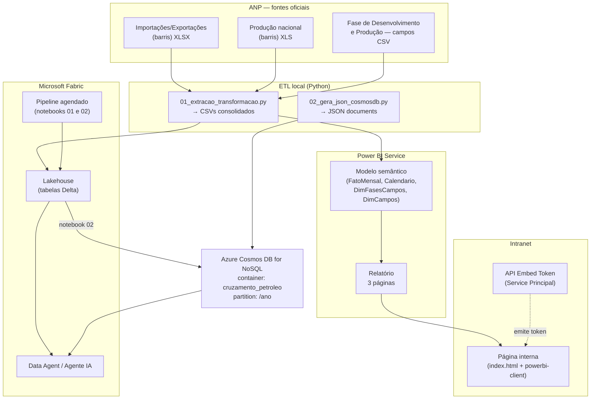

# 01 — Arquitetura da solução

## Visão geral

A solução conecta três mundos em um fluxo único de dados públicos:

1. **Extração** dos dados oficiais da ANP (planilhas estatísticas + dados abertos
   da Fase de Desenvolvimento e Produção);
2. **Curadoria** local em CSVs/JSON padronizados (ETL Python reprodutível);
3. **Consumo analítico** via Power BI publicado na intranet corporativa;
4. **Materialização** do resultado no **Azure Cosmos DB for NoSQL** através do
   **Microsoft Fabric**, servindo como fonte para o **Agente de Análise** (IA).

## Fluxo end-to-end

## Camadas e responsabilidades

| Camada | Componente | Responsabilidade |
|---|---|---|
| Fonte | Planilhas ANP | Dados brutos oficiais, atualização mensal |
| Ingestão | `scripts/*.py` | Parsing do layout “relatório”, tipagem, validações |
| Armazenamento curado | `data/processed/` | Fato mensal/anual + dimensões + JSON Cosmos |
| Analítico | Modelo semântico Power BI | Medidas DAX do cruzamento; governança via workspace |
| Apresentação | Página intranet | Embed seguro do relatório (`app owns data`) |
| Nuvem | Fabric Lakehouse + Pipeline | Reprocessamento agendado na nuvem |
| NoSQL | Cosmos DB container | Documentos por ano; baixa latência p/ agentes |
| IA | Fabric Data Agent / AI Foundry | Perguntas em linguagem natural sobre o cruzamento |

## Princípios adotados

- **Reprodutibilidade**: todo dado derivado nasce de script versionado — nenhum
  valor foi digitado manualmente.
- **Validação dupla**: os totais anuais são confrontados com números publicados
  pela própria ANP (Boletim Mensal, Anuário Estatístico).
- **Segurança**: embed interno com Service Principal + capacity; acesso ao
  Cosmos DB somente via Entra ID (RBAC), sem chaves primárias em código.
- **Baixo acoplamento**: a página web só depende do endpoint interno de token;
  o Cosmos DB é alimentado pelo pipeline da Fabric, não pela página.

## Frequência de atualização

| Processo | Frequência | Gatilho |
|---|---|---|
| Publicação ANP | Mensal (dia subsequente ao mês de referência) | — |
| ETL local → CSVs | Sob demanda / CI | Execução manual ou pipeline GitHub Actions |
| Refresh Power BI | Diário (após carga) | Gateway/agendamento do dataset |
| Pipeline Fabric → Cosmos DB | Mensal (dia 5, 04h UTC) | ScheduleTrigger do pipeline |
