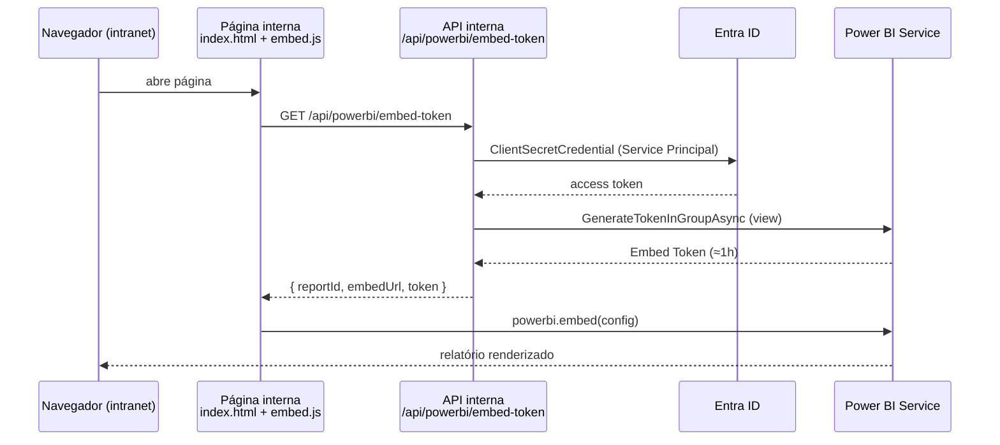

# 04 — Publicação do Power BI na página web interna (intranet)

## Opções de embed — qual usar

| Opção | Público | Custo | Segurança | Veredito p/ intranet |
|---|---|---|---|---|
| **Publish to web** | Internet, anônimo | Grátis | ❌ Pública — proibida p/ dados corporativos | Não usar |
| **Secure Embed (“Embed for your organization”)** | Usuários com licença Pro + AAD da empresa | Licenças Pro | ✅ SSO do tenant | OK se todos têm Pro |
| **Power BI Embedded (“app owns data”)** | Qualquer usuário interno autenticado no app | Capacity F/P/EM/A + SPN | ✅ Token por sessão, sem licença por usuário | **Recomendada** |

O repositório implementa a opção recomendada (*app owns data*).

## Arquitetura do embed



## Passo a passo

### 1. Registrar aplicativo no Entra ID
- Portal Azure → Microsoft Entra ID → App registrations → New registration
  (single tenant) → criar **client secret**;
- Anotar `tenantId`, `clientId`, `secret`.

### 2. Habilitar Service Principal no Power BI
- Fabric Admin Portal → Tenant settings → *Developer settings* →
  **Allow service principals to use Power BI APIs** → Enabled (grupo de segurança).

### 3. Workspace e capacity
- Criar workspace `WS_ANP_Petroleo`; adicionar o Service Principal como
  **Member**;
- Atribuir o workspace a uma **capacity** (Fabric F ou Premium P/EM/A) —
  obrigatória para SPN.

### 4. Publicar e capturar IDs
- Publicar o modelo (docs/03); obter `workspaceId` (URL do workspace) e
  `reportId` (URL do relatório).

### 5. Configurar a API de token
```bash
cd web/api-token-exemplo
dotnet restore && dotnet run
```
Variáveis de ambiente:

```
PBI_TENANT_ID=...
PBI_CLIENT_ID=...
PBI_CLIENT_SECRET=...
PBI_WORKSPACE_ID=...
PBI_REPORT_ID=...
```

### 6. Servir a página interna
Hospede `web/index.html` + `web/embed.js` em qualquer servidor HTTP da intranet
(IIS, nginx, SharePoint via Script Editor Web Part alternativa). O JS busca o
token no endpoint `/api/powerbi/embed-token` **na mesma origem**
(ajuste `ENDPOINT_TOKEN` se necessário) usando cookies de autenticação Windows
da própria intranet — o relatório só aparece para quem já está autenticado.

### 7. Hardening recomendado
- Restringir CORS da API à origem da página interna;
- Guardar o secret em Key Vault (`Azure.Identity` já suporta
  `DefaultAzureCredential` com Managed Identity);
- Logar emissões de token (auditoria);
- Row-Level Security no modelo se diferentes unidades devem ver recortes.

## Alternativa: Secure Embed (sem API)

Se **todos** os usuários internos possuem licença Pro, basta:
1. Relatório → `File` → `Embed report` → **Embed in a secure portal**;
2. Copiar o link gerado;
3. Inserir num `<iframe>` da página interna — o SSO do Entra ID protege o acesso.

Menos flexível (depende de licença por usuário), porém zero código.
